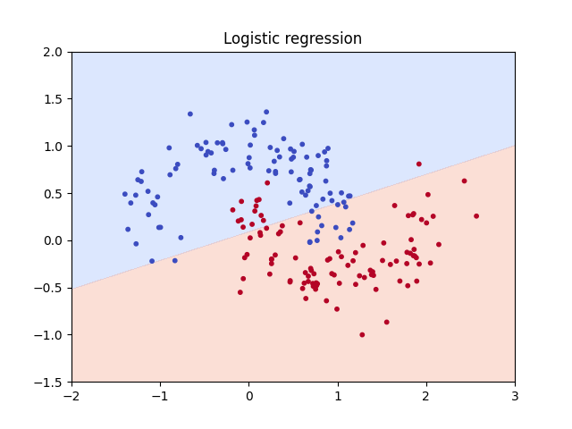
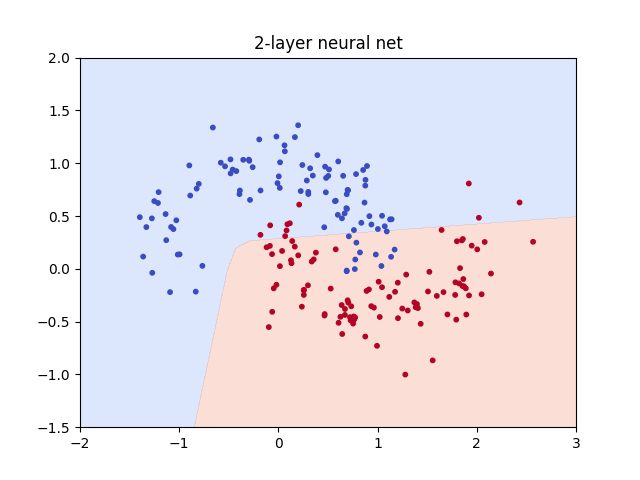
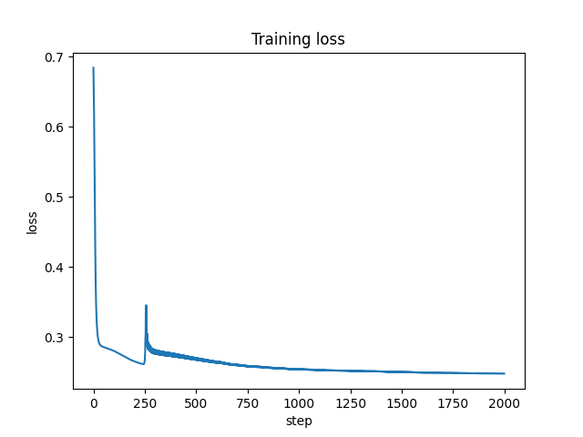
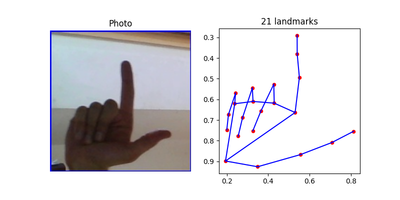
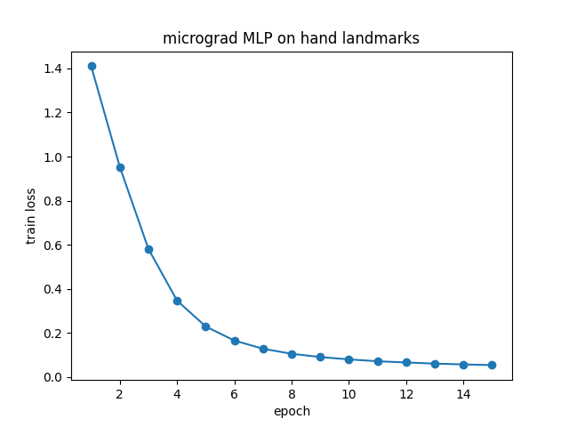

# ASL Translator 🤟

A web app that reads American Sign Language (ASL) letters from your webcam and spells out words live, with the model running entirely in the browser.

I'm building it in 7 days, starting from a neural network written in plain NumPy and finishing with an ONNX model running in a web page.

## Progress

| Day | What | Status |
|---|---|---|
| 1 | 2-layer neural net in NumPy with hand-written backprop | ✅ |
| 2 | micrograd: my own autograd engine | ✅ |
| 3 | micrograd MLP on MediaPipe hand landmarks (5 letters): **96.5% test accuracy** | ✅ |
| 4 | PyTorch MLP on all letters + live webcam test | ⏳ |
| 5 | Small CNN vs landmark MLP on my own hands | ⏳ |
| 6 | Fine-tuned MobileNetV3 + confusion matrix | ⏳ |
| 7 | Browser app (ONNX Runtime Web) + live demo | ⏳ |

## Repo layout

```
src/micrograd/   my autograd engine (engine.py) and neural-net classes (nn.py)
notebooks/       one notebook per day
images/          plots used in this README
```

## Day 1: Neural network from scratch

Before using PyTorch, I wrote a 2-layer network in NumPy, with the forward and backward passes done by hand, to understand exactly what `loss.backward()` does.

**Network:** 2 inputs → 16 hidden (ReLU) → 1 output (sigmoid), binary cross-entropy loss, full-batch gradient descent.

**Data:** `make_moons` (1,000 points, noise 0.2). Two curved shapes that a straight line can't separate.

| Model | Learning rate | Test accuracy |
|---|---|---|
| Logistic regression (baseline) | — | 86% |
| 2-layer NN | 1.0 | 89% |
| 2-layer NN | 10 | 98.5% |
| 2-layer NN | 50 | diverged |

**Backprop verified:** centered finite differences match my analytical gradients, with a max difference of 1.0e-11 across all first-layer weights.

| Logistic regression | 2-layer neural net |
|---|---|
|  |  |



## Day 2: micrograd, my own autograd engine

A `Value` class that wraps a single number, records which operation created it, and knows its local derivative. Calling `.backward()` sorts the graph topologically and applies the chain rule in reverse, so every gradient is computed automatically.

- Operations: `+`, `*`, `tanh`
- Gradients match PyTorch exactly on the same neuron
- Gradients are accumulated with `+=`, so a value used twice (like `a + a`) gets both contributions

## Day 3: My own engine on real hand data

I extended the engine with `exp`, `log`, `pow` and `relu` (subtraction and division come for free from those), built `Neuron`, `Layer` and `MLP` classes on top, and trained it with softmax cross-entropy to tell 5 ASL letters apart: A, B, C, L, Y.

**Input:** MediaPipe's 21 hand landmarks per photo (x, y), centered on the wrist and scaled by hand size, so 42 numbers instead of 120,000 pixels.

**Model:** 42 → 16 (ReLU) → 5, 773 parameters, mini-batch SGD (batch 32, lr 0.1, 15 epochs).

**Split:** the Kaggle *ASL Alphabet* dataset is recorded as video, so neighbouring frames are near-duplicates. I trained on frames 1–2000 and tested on frames 2401–3000 of each letter, leaving a gap to avoid leakage.

| | Accuracy |
|---|---|
| Random guess | 20.0% |
| Train | 99.3% |
| **Test** | **96.5%** |

**Per letter (test):** A 88%, B 100%, C 100%, L 100%, Y 94%. A (a closed fist) is hardest, because its landmarks bunch together.

| Landmarks MediaPipe sees | Training loss |
|---|---|
|  |  |

**Findings**
- MediaPipe found a hand in about 90% of early frames but far fewer late frames, which are darker.
- Training took 13 minutes for 773 parameters, because every number is a separate Python object. Day 4 moves the same math to PyTorch matrices.
- All test photos come from the same signer and room, so the real test is on my own hands (Day 5).

## What I've learned so far
- Without a non-linearity like ReLU, stacked linear layers collapse into one linear layer.
- Every layer's weight gradient follows one pattern: `input.T @ error / n`.
- Gradient checking catches silent backprop bugs that never raise an error.
- The learning rate alone moved Day 1 test accuracy from 89% to 98.5%, and too large a value made training diverge.
- With video datasets, a random train/test split leaks near-duplicate frames into the test set.

## Run it

```bash
pip install -r requirements.txt
jupyter notebook notebooks/day1_numpy_nn.ipynb
```

Day 3 also needs `mediapipe` and `kagglehub`, and the MediaPipe `hand_landmarker.task` model (see the notebook).

## Tech stack
NumPy, scikit-learn, Matplotlib, MediaPipe. Coming this week: PyTorch, OpenCV, ONNX Runtime Web.


